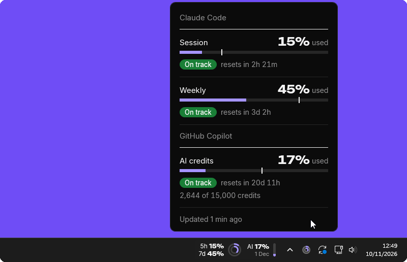
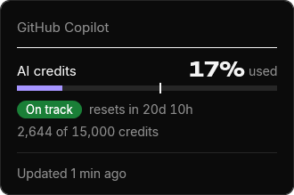
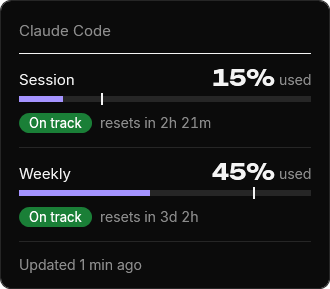
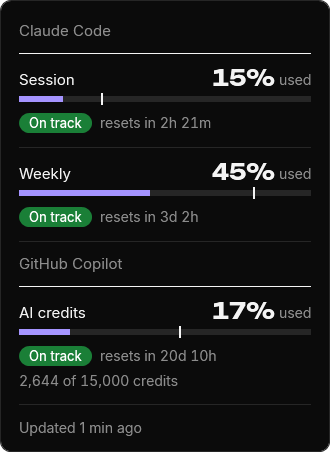
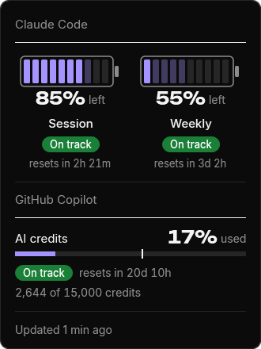
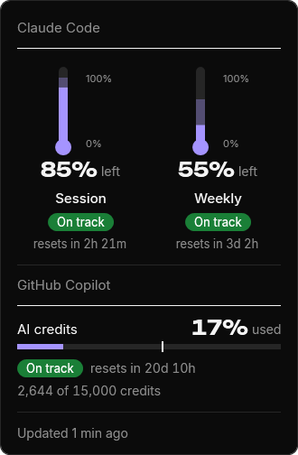
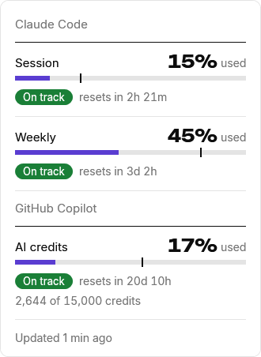
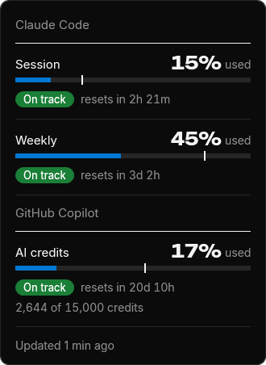
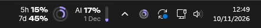
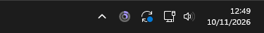

<p align="center">
  
</p>

<h1 align="center">Sobreiro</h1>

<p align="center">
  Your GitHub Copilot and Claude Code usage, always in view on your taskbar.<br>
  Free, for Windows 11. Needs GitHub Copilot with AI credits, or Claude Code on Pro, Max or Ultra.
</p>

<p align="center">
  <a href="https://github.com/RicardoSilveira23/sobreiro/actions/workflows/ci.yml"></a>
  <a href="LICENSE"></a>
</p>

<p align="center">
  <a href="https://github.com/RicardoSilveira23/sobreiro/releases/latest"><b>Download</b></a> ·
  <a href="https://sobreiro.ricardosilveira.dev/">Site</a> ·
  <a href="https://sobreiro.ricardosilveira.dev/manual/">Manual</a> ·
  <a href="#what-it-reads-what-it-sends">What it sends</a> ·
  <a href="#building-from-source">Building</a>
</p>

<p align="center">
  <picture>
    <source srcset="docs/images/readme-demo.webp" type="image/webp" media="(prefers-reduced-motion: no-preference)">
    
  </picture>
</p>

> [!NOTE]
> Sobreiro reads your usage from undocumented addresses at GitHub and Anthropic. Either can change
> at any time, and Anthropic's terms don't allow third-party apps to use Claude sign-ins. If you'd
> rather not, don't install it. When something breaks or reads wrong, please
> [open an issue](https://github.com/RicardoSilveira23/sobreiro/issues).

## Why Sobreiro

GitHub Copilot shows how many of your monthly AI credits you've used on github.com and in the
editors' Copilot menus. Claude Code shows its session and weekly limits when you ask for `/status`,
or in the VS Code extension. Sobreiro keeps those numbers on the taskbar for whichever you use, or
both: a small pill beside the clock and a tray icon for each, with a badge that says whether you're
on track or when you'd run out at this pace. Inspired by
[luisg0nc/claude-pill](https://github.com/luisg0nc/claude-pill), which does this for Hyprland on
Linux. The Battery and Thermometer styles come from the dashboard in
[MSpiechowicz/harness-useful-dashboard](https://github.com/MSpiechowicz/harness-useful-dashboard),
which is worth a look on its own.

## What it shows

- **The pill:** a block for each service, beside the clock. GitHub Copilot's is `AI 17%` over the
  reset date and a small level bar: the monthly AI credits, with a credit budget (Business,
  Enterprise or Pro, not Free). Claude Code's is `5h 9%` over `7d 44%`, the session and the week,
  then two rings; the outer ring is the session.
- **A tray icon for each:** one ring for Copilot, two for Claude Code.
- **Hover** the pill or a tray icon for when each limit resets.
- **Click** it for the details: each limit, what's used or left, when it resets, and the badge.
- **Right-click** it for the menu: the style, the bar colour, what to show and Connect to Claude
  Code.

<table>
  <tr>
    <td></td>
    <td></td>
    <td></td>
  </tr>
  <tr>
    <td align="center">GitHub Copilot</td>
    <td align="center">Claude Code</td>
    <td align="center">Both</td>
  </tr>
</table>

<table>
  <tr>
    <td></td>
    <td></td>
    <td></td>
  </tr>
  <tr>
    <td align="center">Bars, the default: what you've used</td>
    <td align="center">Battery: what's left</td>
    <td align="center">Thermometer: what's left</td>
  </tr>
</table>

Colour and what to show: bars in Sobreiro's purple or your Windows accent, and the pill or just
the tray icon. Right-click the pill or the tray icon. Dark or light follows Windows.

<table>
  <tr>
    <td></td>
    <td></td>
  </tr>
  <tr>
    <td align="center">Light, with Windows</td>
    <td align="center">Your Windows accent</td>
  </tr>
</table>

<table>
  <tr>
    <td></td>
    <td></td>
  </tr>
  <tr>
    <td align="center">The pill and the tray icon</td>
    <td align="center">Just the tray icon</td>
  </tr>
</table>

The [manual](https://sobreiro.ricardosilveira.dev/manual/#shows) has every colour, badge
and setting.

## Run it

1. **Download** `Sobreiro.exe` from the [latest release](https://github.com/RicardoSilveira23/sobreiro/releases/latest).
2. **Run it.** The pill appears beside the clock and fills in within seconds while the Copilot CLI,
   `gh` or Claude Code is signed in. That's it. It is one file and can live anywhere.

For Copilot, sign in with the Copilot CLI or `gh auth login`: Sobreiro doesn't read the sign-in
VS Code or Visual Studio keeps.

Until the app is signed, Windows may warn about an unknown publisher: More info, then Run anyway.
To also take Claude Code's numbers from the terminal, right-click the pill and choose Connect to
Claude Code.
The manual's [Install](https://sobreiro.ricardosilveira.dev/manual/#install) has the rest,
and [Uninstall](https://sobreiro.ricardosilveira.dev/manual/#uninstall) takes it off again.

Coming from the 0.7.0 zip? Quit the old Sobreiro before you run the new exe; the manual's
[Install](https://sobreiro.ricardosilveira.dev/manual/#install) lists the upgrade steps.

## What it reads, what it sends

Every 5 minutes, and when the details open on a reading over a minute old, Sobreiro asks GitHub
for your Copilot AI credits and Anthropic for your Claude Code usage, each with a sign-in already
on this computer. It looks for both sign-ins on every PC, whichever you use, and asks only where it
finds one. These are its only network calls. If you don't want that, don't install it.

- It looks for a GitHub sign-in in this order and stops at the first GitHub accepts: the
  `COPILOT_GITHUB_TOKEN`, `GH_TOKEN` and `GITHUB_TOKEN` variables, the Copilot CLI's sign-in in
  Windows Credential Manager, then `gh auth token --hostname github.com`. It sends any it finds
  only to `GET https://api.github.com/copilot_internal/user`. To find the Copilot CLI's sign-in it
  may list the Credential Manager entries, but only on a PC where the Copilot CLI has been used,
  and it keeps only that one. The request says it is Sobreiro, follows no redirects and keeps no
  cookies. Copilot shows only for a plan with a credit budget.
- It also reads the Copilot CLI's cache file, `%LOCALAPPDATA%\copilot\copilot-user-cache.json`,
  which holds no tokens, for a reading before the first answer and while GitHub can't be reached.
- For Claude Code, it reads only the access token in `.credentials.json`, in the Claude config
  folder (`%USERPROFILE%\.claude`, or `CLAUDE_CONFIG_DIR`), into memory, per request. It calls
  `GET https://api.anthropic.com/api/oauth/usage` with it. Nothing else is sent, no redirects
  are followed and no cookies are kept.
- No token is stored, logged or renewed. The last one can stay in the app's memory until it is
  overwritten, since `HttpClient` takes it as a string property. The app holds no refresh token.
- The status line bridge, `sobreiro-bridge.exe` (Sobreiro copies it from itself to
  `%LOCALAPPDATA%\Sobreiro` when you Connect), saves only the `rate_limits` fields and a
  timestamp to `%LOCALAPPDATA%\Sobreiro\usage.json`, never the rest of what Claude Code passes it.
- Connect to Claude Code changes one key in Claude Code's `settings.json`, `statusLine`, after
  asking and with a backup next to it; Disconnect puts it back. See
  [Connect](https://sobreiro.ricardosilveira.dev/manual/#connect).
- No telemetry and no update checks. The site loads nothing from other hosts either.
- Both addresses are undocumented and can change, and Anthropic's terms don't allow third-party
  apps to use Claude sign-ins.
- The diagnostics log, `log.txt` in the data folder, holds times, the version, exit codes and
  exception type names with stack traces, and one line each time Copilot's poll changes: which
  sources had a token and what GitHub answered. No messages, usage numbers, names, file contents
  or tokens.
  It never leaves the machine.

The manual has the detail: [What it reads and sends](https://sobreiro.ricardosilveira.dev/manual/#data).

## Known limits

- **Terminal only, when Sobreiro can't ask Anthropic.** Then, if you connected it, the numbers
  update only when Claude Code answers in the terminal. The VS Code extension and the desktop app
  don't run the status line.
- **One taskbar.** The pill shows on the primary monitor's taskbar, at the bottom. If it can't find
  the tray icons it hides, and the tray icon carries on.

All six are in the manual's [Known limits](https://sobreiro.ricardosilveira.dev/manual/#limits).

## Building from source

Needs the .NET 10 SDK (`winget install Microsoft.DotNet.SDK.10`) and Git for Windows.

```bash
dotnet build
dotnet test
dotnet publish src/Sobreiro.Bridge -c Release -r win-x64 --self-contained -p:PublishSingleFile=true -p:PublishReadyToRun=true -p:PublishTrimmed=true -o publish/bridge
dotnet publish src/Sobreiro -c Release -r win-x64 --self-contained false -p:PublishSingleFile=true -o publish/tray
```

The tray app finds the bridge next to `Sobreiro.exe` or in `..\bridge\`, which is where those
commands put it, when it doesn't carry one itself. To build the release `Sobreiro.exe`, run
`powershell -ExecutionPolicy Bypass -File scripts\package.ps1` from the repo root; it writes to
`dist\Sobreiro.exe`, the bridge and the fonts included.

- `powershell -ExecutionPolicy Bypass -File scripts\media.ps1` renders every product picture into
  `media/` with `Sobreiro.exe --media` (needs Python 3; it installs Pillow in `scripts\.venv-media`),
  bakes the README hero and copies the site's picks; `scripts\capture-taskbar.ps1` retakes the
  taskbar plate.
- `Sobreiro.exe --snapshot file.png` draws every style in both themes, the tray icon at each
  level, and the taskbar pill, to one PNG.
- To try it without touching your real data folder, set `SOBREIRO_DATA_DIR` to the full path of
  another folder for both the bridge and the tray app.

To release: raise the version in `Directory.Build.props`, merge to `main`, then tag
`v<version>` on `main` and push the tag. The release workflow tests, builds `Sobreiro.exe` and
creates the GitHub Release with it. The tag must equal `v` plus that version, or the workflow fails; a tag with
a suffix, like `v0.6.0-rc.1`, makes a prerelease. CI builds the same file on every pull request
and push to `main`, kept for 14 days as the artifact `Sobreiro-win-x64`.

The site is plain HTML and CSS in `site/`, with no build step. Preview it with
`python -m http.server` from `site/`, or with `npm ci` then `npm run dev` to serve it as
Cloudflare does, and check it with `npm run check`. A Cloudflare Worker serves it: `main` at
<https://sobreiro.ricardosilveira.dev>, and a staging copy and each pull request's preview
behind a GitHub login. [docs/plan.md](docs/plan.md) has the setup.

## Layout

```text
src/Sobreiro/          tray app (WPF with a WinForms tray icon)
src/Sobreiro.Bridge/   status line bridge
src/Sobreiro.Core/     parsing, usage.json, limits, the text shown and the migration (all tested)
tests/Sobreiro.Tests/  xUnit tests: dotnet test
site/                  the website: home page and manual, at sobreiro.ricardosilveira.dev
scripts/               build-icon.py, package.ps1 (release exe), media.ps1 (the pictures), check-site.mjs and smoke.mjs (site checks)
media/                 rendered pictures, regenerated by scripts\media.ps1
.github/workflows/     CI, release and site
wrangler.jsonc         the site's Worker and its domain; package.json pins wrangler
docs/                  plan, brief and design docs; images/ holds only the baked README hero (every other picture comes from media/)
```

## Issues and security

Sobreiro is a one-person project: bugs and ideas go in
[Issues](https://github.com/RicardoSilveira23/sobreiro/issues/new/choose), and pull requests
are open to collaborators only. [CONTRIBUTING.md](CONTRIBUTING.md) says more. Report a
security problem privately, as [SECURITY.md](SECURITY.md) says.

## Licence

Copyright 2026 Ricardo Silveira. Sobreiro is free software under the
[GNU General Public License v3.0 or later](LICENSE): you may use it, change it and share it,
and any copy you hand out, changed or not, stays under the same licence, with its source.
Releases up to 0.8.1 were under MIT.

The bundled fonts, Inter and Unbounded, are under the SIL Open Font License; their licence files
are in `src/Sobreiro/Fonts/`, and the fonts and licences are inside `Sobreiro.exe`; About Sobreiro
shows the licences. The site carries its own copies, in `site/assets/fonts/`.

Not affiliated with or endorsed by Anthropic or GitHub. Sobreiro is the Portuguese name of the cork
oak; its trunk in section is the tray's two rings.
